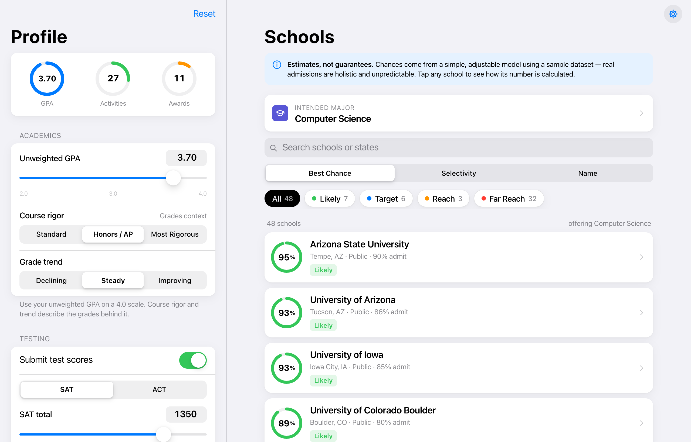
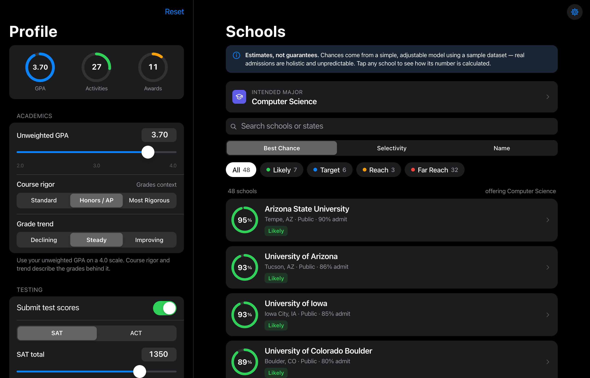
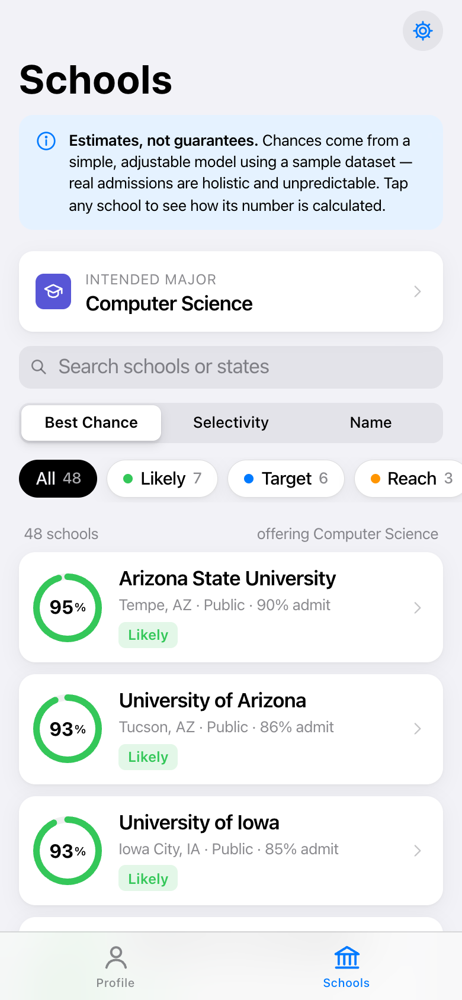
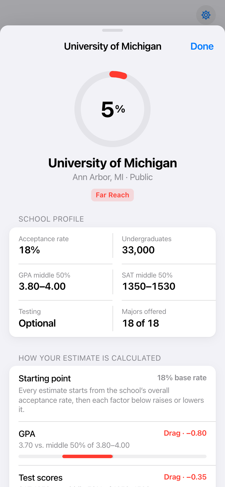
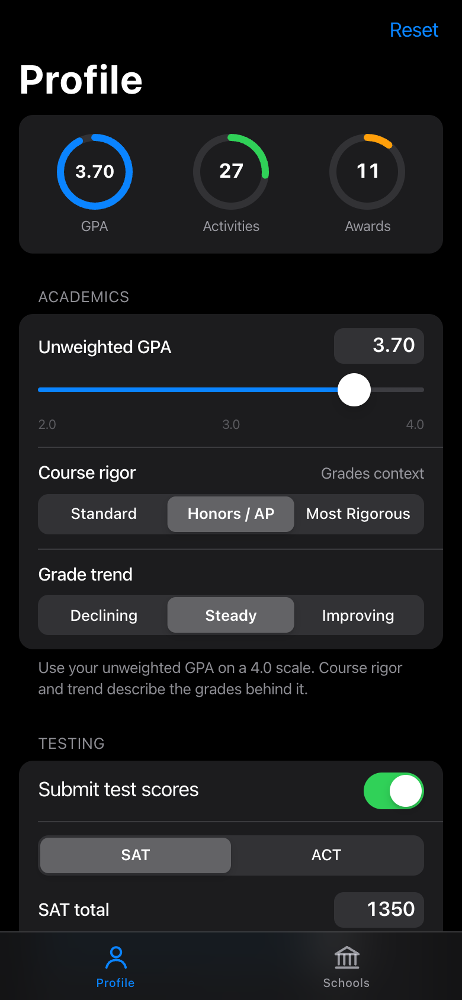

# Admit — College Chance Estimator

A fast, Apple-style web app that estimates a student's **percent chance of admission** at 48 U.S. colleges and filters schools by **intended major**. Change your GPA, course rigor, test scores, activities, or awards, and every school's estimate updates as you type.

> **These are estimates, not guarantees.** The model is a simple, transparent heuristic built on an approximate sample dataset. Real admissions weigh essays, recommendations, context, and institutional priorities that no calculator can see.

## Screenshots

| Desktop (light) | Desktop (dark) |
| --- | --- |
|  |  |

| Schools (mobile) | Score breakdown | Profile (dark) |
| --- | --- | --- |
|  |  |  |

## Features

- **Student profile:** unweighted GPA, course rigor, grade trend, SAT or ACT (or not submitting), extracurricular activities, and honors/awards. It is saved in your browser's `localStorage`.
- **Live estimates:** every change instantly recalculates each school's chance, and the progress rings animate as it moves.
- **Filter by major:** pick an intended major and only schools offering it are shown, each with its estimate. Search, sort (best chance / selectivity / name), and filter by Likely, Target, Reach, or Far Reach.
- **Transparent scoring:** tap a school to see each factor's contribution (GPA, tests, rigor, trend, activities, awards) in a sheet.
- **Native feel:** system font stack (SF Pro on Apple devices), grouped inset lists, segmented controls, toggles, steppers, bottom sheets with swipe-to-dismiss, a collapsing large-title navigation bar, an iOS tab bar on phones, and light/dark/system appearance.
- **Responsive:** two columns on desktop and a tab-based layout on phones.
- **Zero dependencies:** plain HTML, CSS, and ES modules, plus a tiny Node static server.

## Run it locally

Requires **Node.js 18+**. No `npm install` is needed because the project has no dependencies.

```bash
npm start
```

Then open <http://localhost:5173>. Use `PORT=8080 npm start` to change the port.

Run the scoring tests with:

```bash
npm test
```

> Opening `public/index.html` directly from disk won't work, because browsers block `fetch()` of the JSON dataset over `file://`. Use `npm start`.

## How the estimate is calculated

All logic lives in [`public/js/scoring.js`](public/js/scoring.js). All tunable numbers live in [`public/config/weights.js`](public/config/weights.js).

The model works in **log-odds**, the same scale a logistic regression uses. Each factor adds or subtracts from a starting point. The result goes through a sigmoid to become a probability:

```
log-odds = logit(school acceptance rate) + medianAdmitBoost
         + GPA fit + test fit + course rigor + grade trend
         + activities fit + awards fit

chance   = clamp( sigmoid(log-odds), floor, selectivityCap )
```

| Factor | How it's scored |
| --- | --- |
| **Starting point** | The school's acceptance rate, plus a small boost. Someone at the admitted-student median is stronger than the average *applicant*. |
| **GPA fit** | Distance from the school's middle-50% GPA midpoint, in middle-50% widths. There's a minimum width so narrow 3.9–4.0 ranges don't blow up. Being above the median helps with diminishing returns; being below hurts at full strength. Clamped to avoid extremes. |
| **Test fit** | The same calculation against the SAT middle 50%. ACT is converted with a concordance table. If you don't submit: **test-optional** schools apply a tiny penalty, **test-required** schools a large one, and **test-blind** schools ignore scores entirely. |
| **Course rigor** | Standard −0.45 · Honors/AP 0 · Most rigorous +0.4 |
| **Grade trend** | Declining −0.35 · Steady 0 · Improving +0.15 |
| **Activities** | Each activity earns points by impact reach (school → national), scaled by years involved, ×1.4 for a leadership role, plus a small bonus for weekly hours. Your top 10 are summed and converted to a 0–100 strength with diminishing returns: `1 − e^(−points/saturation)`. |
| **Awards** | Points by level (school → international) for your top 5, with the same diminishing-returns curve. |
| **Holistic fit** | Activity and award strength are compared to what a typical admit has at that selectivity. Elite schools expect more *and* weigh it more heavily. |
| **Guard rails** | A 1% floor and a selectivity cap. Schools under 6% acceptance cap at 40%, because even perfect applicants are usually rejected. |

Results are labeled **Likely** (≥ 70%), **Target** (35–70%), **Reach** (12–35%), or **Far Reach** (< 12%). These thresholds are also in `weights.js`.

### Adjusting the model

Edit `public/config/weights.js` and refresh the page. For example:

- Make test scores matter more: raise `academics.testWeight`.
- Give awards more weight than activities: change `holistic.activitiesShare` / `awardsShare`.
- Be more pessimistic overall: lower `baseline.medianAdmitBoost`.

Run `npm test` afterward to confirm the model still behaves sensibly (monotonic in GPA and tests, respects caps, and so on).

## Data

School data lives in [`public/data/colleges.json`](public/data/colleges.json), separate from the code so you can swap in real, current data. Each entry looks like:

```json
{
  "id": "umich",
  "name": "University of Michigan",
  "city": "Ann Arbor", "state": "MI", "type": "Public", "size": 33000,
  "acceptanceRate": 0.18,
  "gpa25": 3.80, "gpa75": 4.00,
  "sat25": 1350, "sat75": 1530,
  "testPolicy": "optional",
  "majors": ["cs", "engineering", "business", "..."]
}
```

- `testPolicy` is `required`, `optional`, or `blind`. Use `null` SAT values for test-blind schools.
- `majors` reference ids in the top-level `majors` array.
- `npm test` validates the file's shape, including unknown majors and inverted ranges.

**The included figures are rounded approximations of publicly reported statistics.** They are for illustration only and have not been verified for any specific admissions cycle.

## Project structure

```
├── server.js                  # zero-dependency static server (npm start)
├── public/
│   ├── index.html
│   ├── styles.css             # Apple HIG–inspired styles, light + dark
│   ├── config/weights.js      # ← every model weight and threshold
│   ├── data/colleges.json     # ← replaceable school dataset
│   └── js/
│       ├── scoring.js         # ← the admission-chance model (pure functions)
│       ├── store.js           # profile/UI state + localStorage
│       ├── icons.js           # SF Symbols–style inline SVG icons
│       ├── app.js             # entry: tabs, navbar, settings, boot
│       └── views/
│           ├── components.js  # segmented control, toggle, ring, helpers
│           ├── sheet.js       # iOS-style modal sheet
│           ├── profile.js     # profile form + activity/award editors
│           └── schools.js     # major filter, list, detail sheet
├── tests/scoring.test.js      # node:test suite for the model + dataset
├── scripts/screenshot.mjs     # regenerates README screenshots (needs Chrome)
└── docs/screenshots/
```

## Assumptions

These are places where the brief was open to interpretation and I chose a reasonable reading:

1. **"Grades" vs. "GPA."** GPA is the numeric average, so "grades" is modeled as the *context* behind it: **course rigor** and **grade trend**. Colleges consistently say they weigh both.
2. **Unweighted GPA on a 4.0 scale**, since that's what most schools report for their middle 50%. Weighted GPAs vary too much between high schools to compare.
3. **SAT is the common test scale.** ACT scores are converted using the published concordance.
4. **Activities and awards** are described by a few structured attributes (reach, years, hours, leadership; award level) instead of free text. That keeps the scoring explainable.
5. **Admissions are not major-specific.** The major filter controls which schools are shown, but doesn't change a school's estimate. Real impacted majors, such as CS at some publics, can be harder; that would be a natural next refinement.
6. **No residency, legacy, recruited-athlete, early-decision, or demographic factors.** These matter in reality but were out of scope and are hard to model fairly.
7. **Persistence is per-browser** (`localStorage`). There are no accounts, backend, or live data APIs, as requested.
8. **SF Symbols can't be redistributed**, so icons are hand-drawn inline SVGs in the same style. The font stack uses SF Pro automatically on Apple devices.

## Regenerating screenshots

With the app running (`npm start`) and Google Chrome installed, run:

```bash
node scripts/screenshot.mjs
```

The URL parameters `?theme=light|dark`, `?tab=profile`, `?major=<id>`, and `?school=<id>` are supported for screenshots and deep links.

## License

MIT
